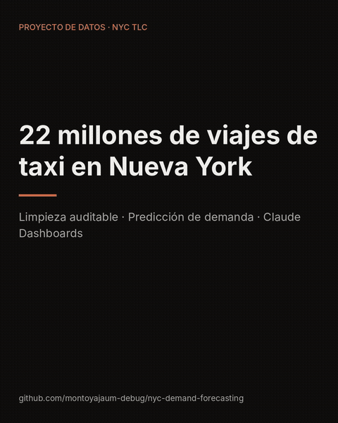
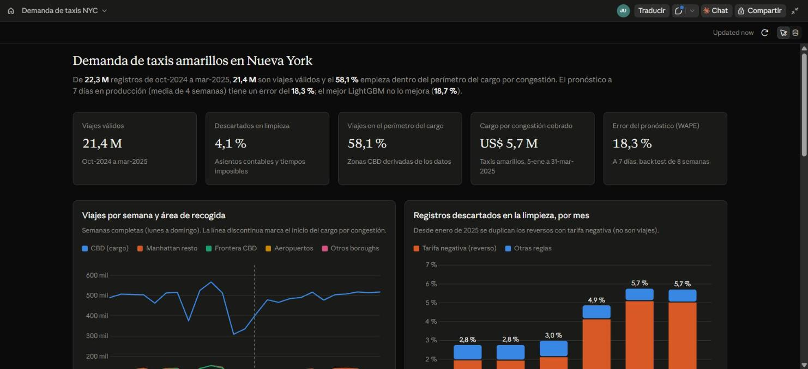
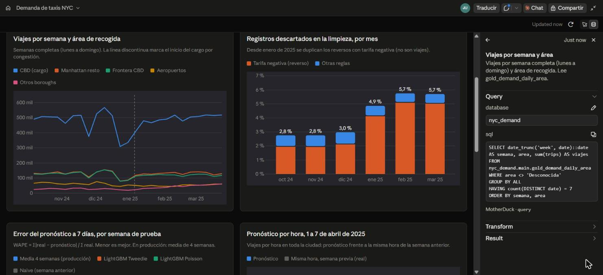
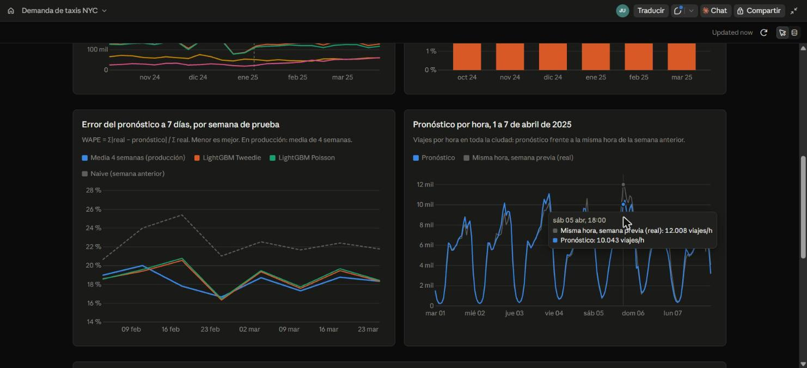
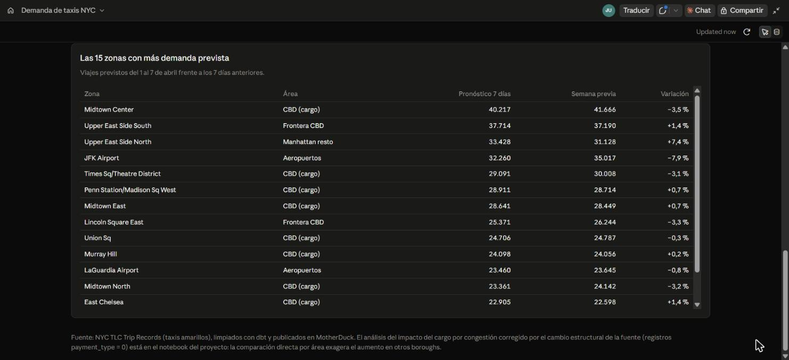
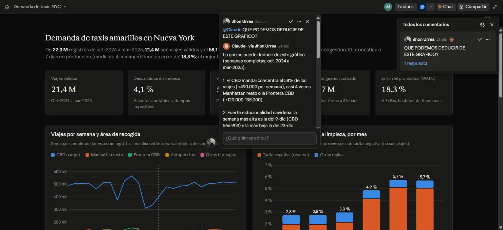
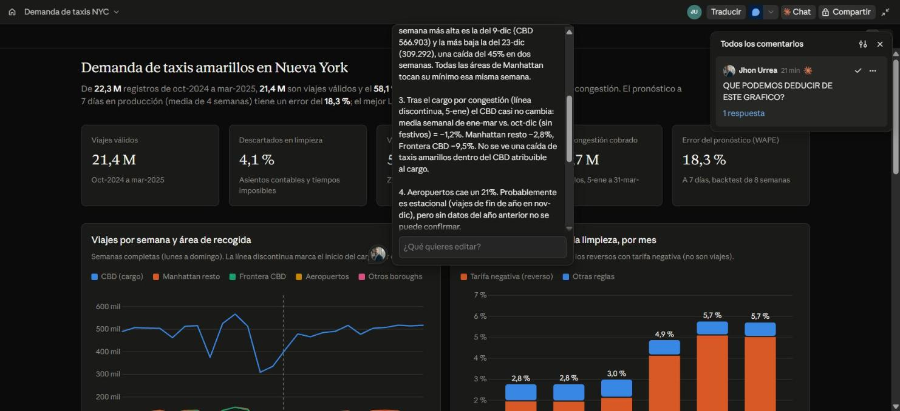

# ¿Cambió el cargo por congestión la demanda de taxis en Nueva York?

**Análisis, limpieza auditable y pronóstico de 22 millones de viajes de taxi amarillo (oct-2024 a mar-2025)**

> **Pregunta.** En enero de 2025 Nueva York empezó a cobrar un cargo por entrar al sur de Manhattan (zona CBD). ¿Redujo los viajes en taxi dentro de esa zona? ¿Se puede pronosticar la demanda por zona y hora con 7 días de antelación?
>
> **Hallazgo.** Dentro del perímetro del cargo los viajes no cayeron más que en el resto de Manhattan (−10% frente a −11%). La aparente subida del 56% en otros barrios no era real: la fuente empezó a registrar de otra forma un tipo de pago. En el pronóstico, un promedio simple de 4 semanas (error del 18,3%) superó a LightGBM (18,7%).
>
> **Recomendación.** Antes de medir el efecto de una política, validar si la fuente cambió su forma de registrar. Y antes de invertir en un modelo complejo, medirlo contra un modelo simple.

**English summary.** Analysis of 22M NYC yellow-taxi trips around the January 2025 congestion pricing. After auditable cleaning (dbt, 29 data tests), trips inside the charge zone did not fall more than in the rest of Manhattan (−10% vs. −11%); an apparent +56% jump in outer boroughs turned out to be a change in how the source records one payment type. For 7-day zone-hour forecasting, a 4-week seasonal average (18.3% WAPE) beat LightGBM (18.7%). Results are published in a Claude Dashboards + MotherDuck dashboard where every figure exposes its SQL.



## Hallazgos

| # | Dato | Qué significa |
|---|---|---|
| 1 | Al comparar antes y después, los viajes en otros barrios suben un **56%**. Al excluir los registros `payment_type = 0`, que pasan de ~10% a ~20% del total desde enero, **todas las áreas bajan entre un 10% y un 19%** | La conclusión obvia (el cargo empujó la demanda hacia afuera) era un artefacto de la fuente |
| 2 | Corregido ese efecto, el CBD cae un **10%** y el resto de Manhattan un **11%** | No hay evidencia de que el cargo redujera los viajes en taxi amarillo dentro de la zona más que fuera de ella |
| 3 | Un filtro rápido habría eliminado el **37%** de los registros; con reglas documentadas se descarta el **4%**, cada uno con su causa | La mayoría de los registros "raros" eran viajes reales con algún campo vacío, no basura |
| 4 | **32 zonas (12%)** generan el **80%** de la demanda; el perímetro del cargo concentra el **58%** de los viajes | Cualquier análisis o pronóstico depende sobre todo de pocas zonas de Manhattan |
| 5 | El pico (jueves, 18 h) es **48 veces** mayor que el valle (martes, 3 h), y el **49%** de las combinaciones zona-hora tiene 0 viajes | El modelo necesita una función de pérdida para conteos (Poisson/Tweedie), no una regresión estándar |
| 6 | LightGBM (WAPE **18,7%**) no superó al promedio de 4 semanas (**18,3%**) en 6 variantes y 8 semanas de backtest; el error mínimo alcanzable por puro azar es ~**9,7%** | La historia de la demanda ya está aprovechada; lo que falta son variables externas (clima, eventos) |

*WAPE: suma de los errores absolutos dividida entre la suma de los viajes reales. CBD: zona del cargo por congestión, al sur de la calle 60, delimitada aquí con los propios datos.*

## Recomendaciones

1. **Validar la fuente antes de evaluar una política** (hallazgos 1 y 2). Separar por proveedor y tipo de registro antes de comparar periodos; aquí ese paso cambió por completo la conclusión.
2. **Usar siempre un modelo simple como referencia** (hallazgo 6). El promedio de 4 semanas se puede poner en producción hoy y ofrece el mismo error que el ML, con menos coste y más transparencia.
3. **Siguiente paso para el pronóstico:** añadir clima por hora y el mismo periodo del año anterior (hallazgo 6 y limitaciones). Es donde está el margen entre el 18,3% actual y el ~9,7% teórico.
4. **Priorizar las zonas densas** (hallazgos 4 y 5). Pronosticar zona-hora en las 57 zonas que concentran el 95% de los viajes y agrupar el resto por área.

## Limitaciones

- **Sin el mismo periodo del año anterior:** la comparación antes/después mezcla el efecto del cargo con la estacionalidad invernal. Se interpreta como diferencia entre áreas, no como efecto causal.
- **Solo taxis amarillos:** no incluye Uber/Lyft, que podrían haber absorbido parte de la demanda.
- **El perímetro del CBD se deriva de los datos** (zonas donde más del 60% de los viajes internos pagan el cargo), no de un mapa oficial.
- **El modelo solo usa historia de la demanda:** sin clima ni eventos.

## Dashboard (Claude Dashboards + MotherDuck)

Construido con **Claude Dashboards** sobre las tablas publicadas en **MotherDuck**. Cada cifra y gráfico es una consulta SQL en vivo
que se puede revisar en el panel *Sources*. También se puede **comentar cualquier gráfico** mencionando a @Claude, y la respuesta
llega en el mismo hilo, calculada con los datos. Consultas: [`dashboards/sql/`](dashboards/sql/) · Video: [`docs/video/nyc_dashboard_linkedin.mp4`](docs/video/nyc_dashboard_linkedin.mp4)

| Resumen | Cada número muestra su SQL |
|---|---|
|  |  |
| **Backtest y pronóstico a 7 días** | **Zonas con más demanda prevista** |
|  |  |
| **Pregunta en un comentario sobre el gráfico** | **Claude responde en el hilo con datos** |
|  |  |

Análisis completo: [`notebooks/01_eda.ipynb`](notebooks/01_eda.ipynb) · Modelo: [`reports/model/MODELO.md`](reports/model/MODELO.md) · Limpieza: [`reports/quality/DECISIONES_LIMPIEZA.md`](reports/quality/DECISIONES_LIMPIEZA.md)

| Variación por área, antes y después de corregir la fuente | Error del pronóstico a 7 días |
|---|---|
|  |  |

## Cómo funciona

```
TLC (Parquet mensual) → ingest.py → bronze (crudo) → perfilado de calidad
   → silver (limpio, dbt) → gold (agregados) → backtest + pronóstico (LightGBM / baseline)
   → MotherDuck (solo tablas agregadas, ~15 MB) → Claude Dashboards
```

**Stack:** Python · DuckDB · dbt-duckdb · LightGBM · MLflow · MotherDuck · Claude Dashboards

Todo el procesamiento pesado corre en local y sin coste; a la nube solo suben las tablas agregadas, dentro del plan gratuito de MotherDuck.

## Calidad de datos

Antes de limpiar, cada mes se perfila contra 17 reglas candidatas (`src/quality/profile_yellow.py`); los reportes quedan en
`reports/quality/`. Las decisiones (descartar, corregir o marcar) se documentan con el % de filas afectadas en
[`DECISIONES_LIMPIEZA.md`](reports/quality/DECISIONES_LIMPIEZA.md).

**Oct-2024 a mar-2025:** 22,3 M registros → **21,4 M viajes válidos** (94–97% por mes), descartes con causa auditable.
29 pruebas de datos en dbt, incluida la conciliación bronze = silver + rechazados. La validación en 6 meses detectó un
proveedor nuevo (VendorID 7) que no registra la hora de llegada y el cambio estructural en la fuente desde enero de 2025.

## Cómo reproducir

```bash
python -m venv .venv
.venv\Scripts\activate            # Windows (Linux/Mac: source .venv/bin/activate)
pip install -r requirements.txt

# 1. Ingesta de los 6 meses analizados (bronze, ~380 MB)
python src/ingest/ingest.py --services yellow --start 2024-10 --end 2025-03

# 2. Perfilado de calidad de un mes (no modifica datos)
python src/quality/profile_yellow.py data/bronze/yellow/year=2025/month=01/yellow_tripdata_2025-01.parquet

# 3. Limpieza + capa gold + 29 pruebas de datos
cd dbt_project
dbt build --profiles-dir .
cd ..

# 4. EDA
jupyter notebook notebooks/01_eda.ipynb

# 5. Modelo: backtest de 8 semanas + pronóstico a 7 días
python src/ml/train.py

# 6. Publicar tablas agregadas en MotherDuck (token en variable de entorno, nunca en el código)
$env:motherduck_token = "<tu token de MotherDuck>"      # PowerShell, solo para la sesión actual
python src/publish/to_motherduck.py
```

## Estructura

```
src/ingest/      ingesta incremental con log de auditoría
src/quality/     perfilado de calidad
src/ml/          variables (rezagos >= 7 días, sin fuga de información), backtest, pronóstico y reporte
src/publish/     carga de tablas agregadas a MotherDuck para Claude Dashboards
dbt_project/     modelos silver (limpieza) y gold (zonas, demanda zona-hora, demanda diaria por área)
dashboards/      consultas SQL del dashboard en Claude Dashboards
notebooks/       EDA ejecutado (01_eda.ipynb)
reports/         decisiones de limpieza, perfiles mensuales y resultados del modelo
docs/            gráficos, capturas del dashboard y video demo
data/            (ignorado por git)
```

## Fuente de datos

NYC Taxi & Limousine Commission, TLC Trip Record Data: https://www.nyc.gov/site/tlc/about/tlc-trip-record-data.page

## Autor

**Jhon Alexander Urrea Montoya**, analista de datos y BI · [LinkedIn](https://www.linkedin.com/in/jhon-urrea-data) · Desarrollado con Claude (Anthropic) como asistente de código.
