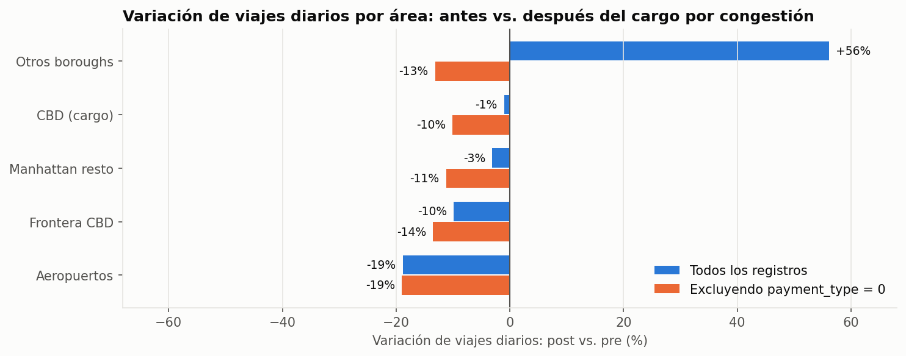
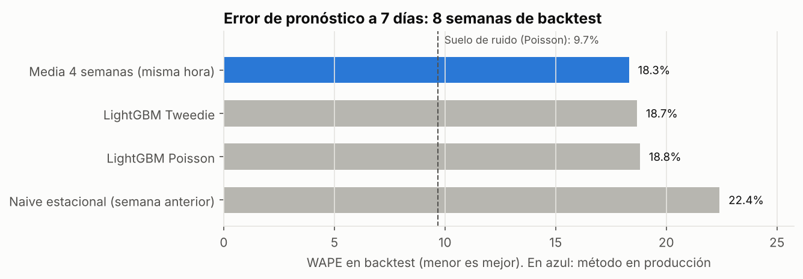

# NYC Demand Forecasting — Pipeline Big Data + ML + Claude Dashboards

> Predicción de demanda de viajes por zona y hora en Nueva York (NYC TLC Trip Records)
> y análisis del impacto del cargo por congestión (enero 2025).

**Estado:** 🟢 Fase 1 (ingesta + calidad + silver) · 🟢 Fase 2 (gold + EDA) · 🟢 Fase 3 (modelo predictivo) · 🟡 Fase 4 (MotherDuck + Claude Dashboards)

## Hallazgos principales (oct-2024 a mar-2025)

| | |
|---|---|
| **Volumen** | ~117.700 viajes/día; mínimo de 52.492 el 25-dic |
| **Patrón horario** | Pico jueves 18 h vs. valle martes 3 h: **48×** |
| **Concentración** | 32 zonas (12%) generan el 80% de la demanda; el perímetro del cargo por congestión, el 58% |
| **Cargo por congestión** | La comparación ingenua muestra +56% de viajes en otros boroughs. **Es un artefacto de la fuente** (registros `payment_type = 0`). Corregido, el CBD (−10%) no cae más que el resto de Manhattan (−11%) |
| **Para el modelo** | 49% de las horas-zona tienen 0 viajes → pérdida para conteos (Poisson/Tweedie) |
| **Modelo predictivo** | A 7 días, LightGBM (WAPE 18,7%) **no supera** a la media de 4 semanas (18,3%) tras 6 variantes probadas. Se publica el baseline. El suelo de ruido (9,7%) indica que el margen restante depende de variables externas (clima, eventos) |



Análisis completo: [`notebooks/01_eda.ipynb`](notebooks/01_eda.ipynb) · Modelo: [`reports/model/MODELO.md`](reports/model/MODELO.md)



## Arquitectura

```
TLC (Parquet mensual) → ingest.py → bronze (crudo) → perfilado de calidad
   → silver (limpio, dbt) → gold (agregados) → LightGBM → predicciones
   → MotherDuck → Claude Dashboards + Power BI
```

## Stack
DuckDB · dbt-duckdb · LightGBM · MLflow · MotherDuck · Claude Dashboards · Power BI

## Cómo reproducir

```bash
python -m venv .venv
.venv\Scripts\activate            # Windows
pip install -r requirements.txt

# 1. Ingesta (bronze)
python src/ingest/ingest.py --services yellow --start 2025-01 --end 2025-01

# 2. Perfilado de calidad (no modifica datos)
python src/quality/profile_yellow.py data/bronze/yellow/year=2025/month=01/yellow_tripdata_2025-01.parquet

# 3. Limpieza + capa gold + 29 tests de datos
cd dbt_project
dbt build --profiles-dir .
cd ..

# 4. EDA
jupyter notebook notebooks/01_eda.ipynb

# 5. Modelo: backtest de 8 semanas + pronóstico a 7 días (~10 min)
python src/ml/train.py

# 6. Publicar tablas agregadas en MotherDuck (token en variable de entorno, nunca en el código)
$env:motherduck_token = "<tu token>"      # PowerShell, solo para la sesión actual
python src/publish/to_motherduck.py
```

## Calidad de datos
Antes de limpiar, cada mes se perfila contra 17 reglas candidatas
(ver `src/quality/profile_yellow.py`). Los reportes quedan en `reports/quality/`.
Las decisiones de limpieza (descartar / corregir / marcar) se documentan con el % de filas afectadas
en [`reports/quality/DECISIONES_LIMPIEZA.md`](reports/quality/DECISIONES_LIMPIEZA.md).

**Oct-2024 a mar-2025:** 22,3 M registros → **21,4 M viajes válidos (94–97% por mes)**, descartes con causa
auditable. Un filtro ingenuo habría eliminado el 37%. 29 tests de datos en dbt en verde, incluida la conciliación
bronze = silver + rechazados. La validación multi-mes detectó un proveedor nuevo (VendorID 7) sin hora de
llegada y un cambio estructural en la fuente desde enero 2025.

## Estructura
```
src/ingest/      ingesta incremental con log de auditoría
src/quality/     perfilado de calidad
src/ml/          features (rezagos >= 7 días, sin fuga), backtest, pronóstico y reporte
src/publish/     carga de tablas agregadas a MotherDuck (~15 MB) para Claude Dashboards
dbt_project/     modelos silver (limpieza) y gold (dim_zone, demanda zona-hora, demanda diaria por área)
notebooks/       EDA ejecutado (01_eda.ipynb)
docs/img/        gráficos del EDA
dashboards/      SQL y capturas de Claude Dashboards
reports/quality/ reportes de calidad por mes
reports/model/   resultados del modelo (MODELO.md, métricas por semana)
data/            (ignorado por git)
```

## Fuente de datos
NYC Taxi & Limousine Commission — TLC Trip Record Data.
https://www.nyc.gov/site/tlc/about/tlc-trip-record-data.page
