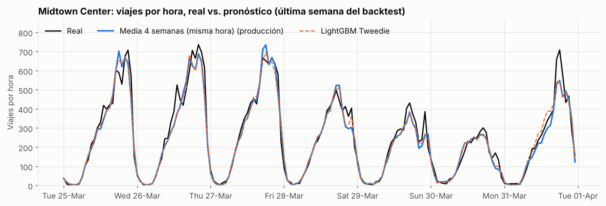
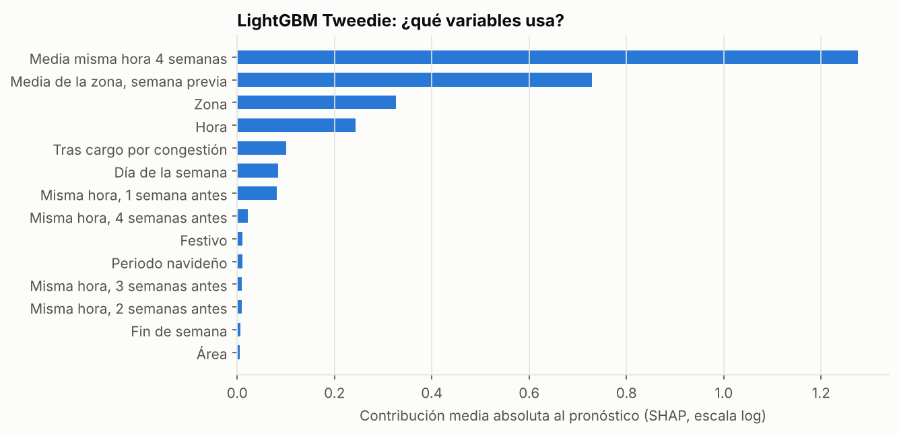

# Modelo de demanda zona-hora — resultados

Pronóstico a **7 días (168 h)** de viajes de taxi amarillo por zona de recogida y hora. Backtest de origen móvil con **8 semanas** (04-Feb-2025 a 25-Mar-2025); en cada corte se entrena solo con el pasado.

## Resultado

**El modelo de machine learning no supera al baseline.** El mejor LightGBM (LightGBM Tweedie) obtiene un WAPE 18.7% frente a 18.3% de Media 4 semanas (misma hora) (un 2.0% peor). Regla de producción: un modelo complejo solo se publica si mejora al simple en más de un 2%. **En producción: Media 4 semanas (misma hora).**

El suelo de ruido Poisson estimado es **9.7%**: hay margen de mejora, pero no con las variables disponibles (solo historia de la propia demanda). Ver *Experimentos* más abajo.

| Método | WAPE total | WAPE zonas densas | WAPE zonas intermitentes | MAE (viajes/h) | Sesgo | Desv. WAPE entre semanas |
|---|---:|---:|---:|---:|---:|---:|
| Naive estacional (semana anterior) | 22.4% | 19.0% | 64.2% | 4.40 | -0.9% | 1.5% |
| Media 4 semanas (misma hora) ⭐ producción | 18.3% | 15.5% | 53.5% | 3.60 | -2.9% | 1.0% |
| LightGBM Poisson | 18.8% | 16.0% | 53.1% | 3.69 | +1.6% | 1.2% |
| LightGBM Tweedie | 18.7% | 16.0% | 52.1% | 3.67 | +1.2% | 1.2% |

- **WAPE** = Σ|real − pronóstico| / Σ real. Se usa en vez de MAPE porque el 49% de las horas-zona tienen 0 viajes (MAPE sería infinito).
- **Zonas densas**: < 10% de horas sin viajes (calculado solo con datos previos al backtest).
- **Sesgo** > 0 = el modelo sobreestima en total.

## WAPE por semana de test

| Semana desde | Naive estacional (semana anterior) | Media 4 semanas (misma hora) | LightGBM Poisson | LightGBM Tweedie |
|---|---:|---:|---:|---:|
| 04-Feb-2025 | 20.7% | 19.0% | 18.6% | 18.6% |
| 11-Feb-2025 | 24.0% | 20.0% | 19.6% | 19.4% |
| 18-Feb-2025 | 25.4% | 17.8% | 20.8% | 20.6% |
| 25-Feb-2025 | 21.0% | 16.7% | 16.5% | 16.3% |
| 04-Mar-2025 | 22.5% | 18.7% | 19.5% | 19.4% |
| 11-Mar-2025 | 21.7% | 17.3% | 17.7% | 17.6% |
| 18-Mar-2025 | 22.4% | 18.8% | 19.7% | 19.5% |
| 25-Mar-2025 | 21.8% | 18.3% | 18.4% | 18.3% |

## Experimentos realizados (backtest de 8 semanas, WAPE total)

| Variante | WAPE | Conclusión |
|---|---:|---|
| LightGBM Tweedie, variables base | 18,7% | Referencia ML |
| + mediana 4 semanas, tendencia zona y nivel ciudad | 19,0% | Empeora: descartadas |
| Aprender correcciones sobre la media 4 semanas (`init_score`) | 19,4% | Empeora |
| Entrenar solo con el régimen actual (desde 6-ene-2025) | 19,3% | Empeora: menos datos, sesgo +2,6% |
| Todo el histórico sin variables de régimen | 18,6% | Similar |
| Promedio 50/50 de LightGBM y media 4 semanas | 18,3% | Igual al baseline (18,3%) |

**Lectura:** el baseline ya captura casi toda la señal que contiene la historia de la demanda. La distancia al suelo de ruido corresponde a factores externos que el modelo no ve (clima, eventos, tormentas). Siguiente paso: incorporar clima horario (Open-Meteo).

## Variables

Todas las variables de historia usan rezagos ≥ 168 h: el modelo nunca ve información que no estaría disponible al pronosticar con 7 días de antelación. No se usan `payment_type`, pasajeros ni RatecodeID porque cambiaron de composición en ene-2025 (ver `reports/quality/DECISIONES_LIMPIEZA.md`).

| Variable | Importancia SHAP | Ganancia (%) |
|---|---:|---:|
| Media misma hora 4 semanas | 1.276 | 89.6% |
| Media de la zona, semana previa | 0.728 | 0.8% |
| Zona | 0.326 | 0.5% |
| Hora | 0.243 | 0.2% |
| Tras cargo por congestión | 0.101 | 0.1% |
| Día de la semana | 0.084 | 0.1% |
| Misma hora, 1 semana antes | 0.081 | 8.0% |
| Misma hora, 4 semanas antes | 0.022 | 0.2% |
| Festivo | 0.011 | 0.2% |
| Periodo navideño | 0.010 | 0.1% |
| Misma hora, 3 semanas antes | 0.010 | 0.1% |
| Misma hora, 2 semanas antes | 0.009 | 0.1% |
| Fin de semana | 0.006 | 0.0% |
| Área | 0.005 | 0.0% |

## Pronóstico generado

Tabla `pred_demand_zone_hour` (y `data/predictions/pred_20250401.parquet`): 168 h desde 01-Apr-2025 para cada zona. `pred_trips` = método en producción (Media 4 semanas (misma hora)); también incluye la predicción de LightGBM Tweedie para comparación.

## Limitaciones

- 6 meses de historia: el modelo no ha visto un año completo (estacionalidad anual, verano).
- Sin variables externas (clima, eventos). Son las siguientes candidatas.
- El backtest cubre feb-mar 2025, tras el cambio estructural de la fuente en enero.